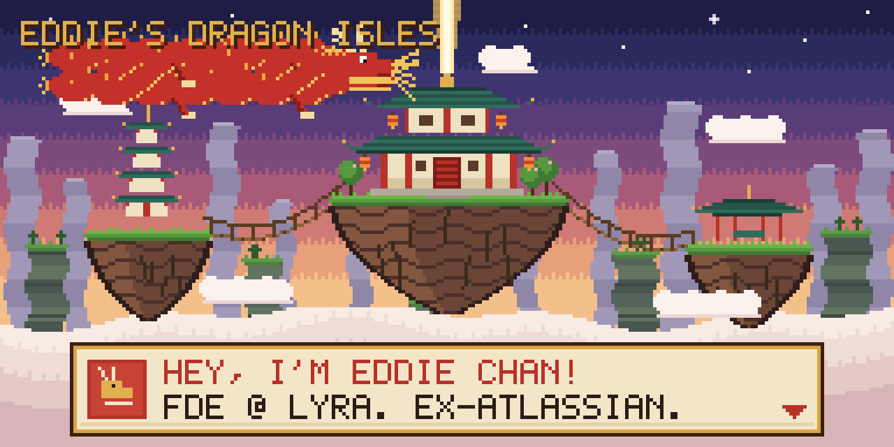

### 你好, I'm Eddie (陈嘉豪) 🐉

In Chinese there's a phrase, **望子成龙** (*wàng zǐ chéng lóng*): parents hoping their child grows up to become a dragon. I took it literally and built [my portfolio](https://eddiechann.com) as a sky you fly through as one.

I'm a **forward deployed engineer at [Lyra](https://lyratechnologies.com.au)**, doing founding-engineer work for Silicon Valley startups, and a software engineer at **boringstack.ai**. Before that, I built filters in Compass end to end at **Atlassian**, interned at **Culture Amp**, **Monash University** and **Deloitte**, and ran the Monash Association of Coding.

### 🏝️ What you'll find here

| | Project | What it is | Built with |
|---|---|---|---|
| 🐉 | **[eddie-dragon-isles](https://github.com/elitevortex/eddie-dragon-isles)** | My portfolio as a 3D game. Fly a dragon between floating islands, breathe fire, change the seasons and read my story inside each temple. Multiplayer, so you share the sky with whoever else is on the site | Three.js, Web Audio, MediaPipe hand tracking, Cloudflare Durable Objects |
| 🧠 | **[leetup](https://github.com/elitevortex/leetup)** | Strava for LeetCode, with BeReal's lock. Post a solve to unlock what your friends solved today. Every post is verified against a real accepted submission | React Native, Expo, Supabase, Postgres row-level security, Deno edge functions |
| 📸 | **[meme-cam](https://github.com/elitevortex/meme-cam)** | Strike a pose at your webcam and the matching meme plays over your face. Tracks your face, hands and body in real time, all on your laptop | Python, MediaPipe, OpenCV |

### 🛠️ What I work with

**Languages:** TypeScript, JavaScript, Python, SQL
**Frontend:** React, React Native, Three.js
**Backend and cloud:** Node, Postgres, Supabase, AWS (Lambda, CDK, S3), Cloudflare Workers, Vercel
**Lately:** building with AI agents, and shipping fast for early-stage teams

### 📜 Come say hi

<a href="https://eddiechann.com">eddiechann.com</a> · <a href="https://www.linkedin.com/in/edwrdchn/">LinkedIn</a> · <a href="https://www.instagram.com/eddie_chann/">Instagram</a>

The banner is pixel art drawn by <a href="scripts/banner.mjs">a script</a>, not an image editor. Run <code>node scripts/banner.mjs</code> to redraw it.
